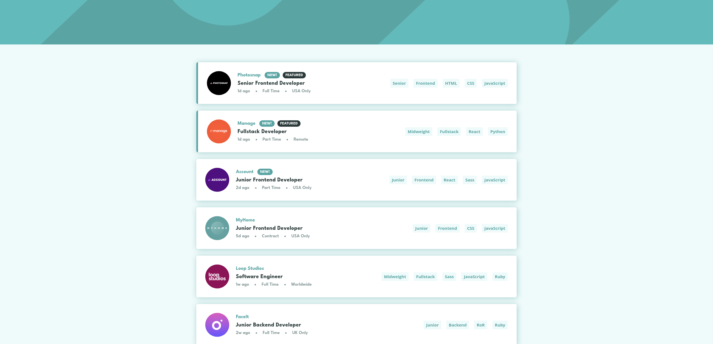

# Frontend Mentor - Job listings with filtering solution

This is a solution to the [Job listings with filtering challenge on Frontend Mentor](https://www.frontendmentor.io/challenges/job-listings-with-filtering-ivstIPCt). Frontend Mentor challenges help you improve your coding skills by building realistic projects. 

## Table of contents

- [Overview](#overview)
  - [The challenge](#the-challenge)
  - [Screenshot](#screenshot)
  - [Links](#links)
- [My process](#my-process)
  - [Built with](#built-with)
  - [What I learned](#what-i-learned)
  - [Continued development](#continued-development)
  - [Useful resources](#useful-resources)
  - [AI Collaboration](#ai-collaboration)
- [Acknowledgments](#acknowledgments)


## Overview

### The challenge

Users should be able to:

- View the optimal layout for the site depending on their device's screen size
- See hover states for all interactive elements on the page
- Filter job listings based on the categories

### Screenshot




### Links

- Solution URL: [Add solution URL here](https://github.com/Zuzana83/Job-listing)
- Live Site URL: [Add live site URL here](https://zuzana83.github.io/Job-listing/)

## My process

### Built with

- Semantic HTML5 markup
- CSS custom properties
- Flexbox
- CSS Grid
- Mobile-first workflow
- Vanilla JavaScript (no frameworks or libraries)

### What I learned

This project is the second, "official" version of a challenge I first attempted on my own, rebuilt with a specific mission: fix the architectural flaws I suspected in my first attempt and treat accessibility as a first-class feature instead of an afterthought. Following my usual approach of picking two or three genuinely new territories per project, this one had three:

Normalizing externally shaped data. The challenge's JSON scatters each job's filterable tags across four fields — role and level as strings, languages and tools as (sometimes empty) arrays — while my filtering logic wanted one flat array per job, like my first version had. Instead of rewriting the filter to interrogate four fields forever, I flattened the data once at load time:

```js
const jobTags = [job.level, job.role, ...job.tools, ...job.languages];
const newJob = { ...job, jobTags };
```
Translation at the border, native shape inside — the four-part template for rendering tag buttons collapsed into a single .map(), and the filtering logic survived the data-format change completely unchanged.

Territories 2 and 3: Keyboard operation and focus, as features. Together they forced the biggest idea of the rebuild, which fixes the central flaw of my first version: derive the view from state, never mutate the source.

My first version kept a copy of the data and filtered that copy into itself on every click. It seemed to work, because filtering a shrinking array by a new tag happens to produce correct results — right up until the moment a filter was removed, when the destroyed data could no longer answer "which jobs match only the remaining filters?" The rebuild replaced that design with two module-level state holders — the pristine normalized job list and an array of active filter tags — and a single updateUI() function that derives everything from them:

```js
function updateUI(refocus = false) {
    const filteredJobList = allJobs.filter(job =>
        activeTags.every(tag => job.jobTags.includes(tag))
    );
    // render cards, render filter chips, toggle visibility, announce status...
}
```

Every interaction — adding a tag, removing one, clearing all — became "modify activeTags, call updateUI()." No special cases, no recovery logic. A detail I'm proud of: clearing filters required no branch at all, because [].every(...) is true for every job — "no requirements" satisfies itself mathematically. My first version's painful special-case code for the empty-filters state simply dissolved.

The focus-management lesson began as a bug I could feel but not see. During testing I activated a filter with Enter and the focus ring vanished: my updateUI() replaces the cards via innerHTML, which destroys the element holding focus, and the browser silently drops focus to the page — so every Tab restart walked the whole list from the top. Diagnosing it meant predicting where focus should be and letting the browser disagree with me. The fix required knowing who triggered the update: keyboard activation synthesizes a click event with detail === 0, which became the signal for updateUI(refocus) to repair focus after rendering — first skill button of the results, falling back to the first filter chip's remove button when nothing matches. Removing a chip needed its own strategy: keep focus on the next remaining chip (the user is editing their query, so keep their hands on the query controls), with a guard for removing the last chip, where I fell back to the results instead of crashing:

```js
if (focusedBtn) {
    focusedBtn.focus();
} else {
    const skillBtn = jobsContainer.querySelector(".skill_btn");
    skillBtn?.focus();
}
```

Mouse users get none of this movement — clicks never reposition focus or scroll — because their pointer is their position, and a viewport that yanks away from the user's hand is hostility, not polish.

Supporting accessibility decisions surfaced small but instructive lessons throughout: aria-label silently does nothing on a plain <div>, so the filter chips became a real <ul> with the label attached to it. The filter-count announcement lives in its own visually-hidden role="status" element, deliberately outside the container that toggles display: none, since a live region can't announce while it's hidden — and it writes distinct grammar for zero, one, and many results. The error toast uses role="alert" with its message inserted dynamically at failure time.

One bug taught me a delegation lesson I'll reuse constantly: my remove-chip button worked only every third or fourth click. The cause was e.target matching the inner <svg> icon, not the button. Switching both delegated handlers to e.target.closest(".closeBtn") eliminated the entire class of child-element mismatch, and taught me to read a flaky bug as geometry, not chance.


### Continued development

-Test all announcements (filter counts, the error toast) with a real screen reader such as Orca or NVDA — the patterns I chose are the documented-reliable ones, but empirical verification with actual assistive tech is the standard I want to hold.

### Useful resources

-  [MDN Web Docs](https://developer.mozilla.org/) - My first stop for closest(), Array.prototype.every(), optional chaining, :focus-visible, and the fetch/Response API — especially the page confirming that fetch does not reject on HTTP errors, which is why the resp.ok check exists.
- After reading MDN, I generally search for real-world implementations of the same concept to see the theory applied in an actual project, which usually helps it click faster than the reference documentation alone.

### AI Collaboration

- I used AI as a mentor, the same way as my previous projects — working through concepts in plain English before writing code, drafting my own implementations, testing against real data, and iterating on what I observed. For this project the highest-value moments were tracing state by hand: walking through which array each filter read from


## Acknowledgments

Thanks to this AI mentor/guide approach I am able to solve more complex projects, learn new concepts, explore more advanced javascript which I would not be able to do just on my own, without verifying I understand theory and implement it correctly.

